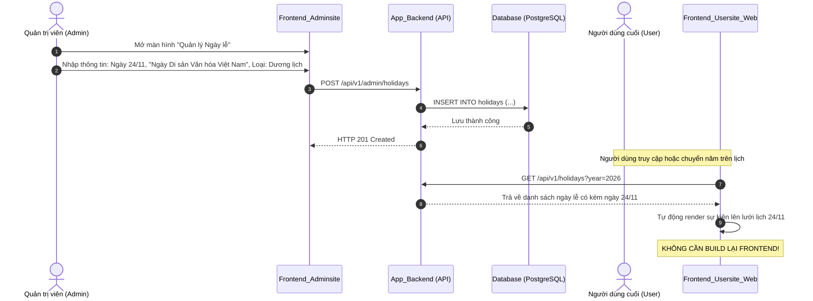

# HƯỚNG DẪN KIẾN TRÚC TÍCH HỢP DỮ LIỆU NGÀY LỄ TỪ BACKEND
*(Không cần build lại Frontend khi có ngày lễ mới)*

---

## 1. TỔNG QUAN & MỤC TIÊU
Khi Nhà nước hoặc các cơ quan ban hành thêm ngày lễ, ngày kỷ niệm mới (ví dụ: **Ngày 24/11 - Ngày Di sản Văn hóa Việt Nam**, hoặc các ngày nghỉ hoán đổi/nghỉ bù đột xuất theo chỉ thị của Thủ tướng), hệ thống cần đảm bảo:
- **Zero Build / Zero Code Change:** Không cần lập trình viên can thiệp vào code, không cần build và deploy lại ứng dụng Frontend (`Frontend_Usersite_Web`).
- **Dynamic Configuration:** Quản trị viên nhập dữ liệu trực tiếp từ trang Admin (`Frontend_Adminsite`) $\rightarrow$ Dữ liệu lưu vào Database $\rightarrow$ Phía người dùng lập tức thấy ngày lễ mới trên lịch.
- **Offline-First & Graceful Fallback:** Khi mất kết nối mạng hoặc Backend bảo trì, Frontend sử dụng **Thuật toán Thiên văn Hồ Ngọc Đức** và danh mục văn hoá tích hợp sẵn để không bao giờ bị trắng trang.

---

## 2. THIẾT KẾ CƠ SỞ DỮ LIỆU (DATABASE SCHEMA)

Bảng `holidays` trong Database (`App_Backend` - PostgreSQL/MySQL hoặc MongoDB) cần hỗ trợ 3 loại ngày lễ:
1. `SOLAR`: Ngày lễ Dương lịch cố định hàng năm (ví dụ: `24/11`, `31/10`, `25/12`).
2. `LUNAR`: Ngày lễ Âm lịch lặp lại hàng năm (ví dụ: `10/3` Giỗ Tổ, `15/8` Trung Thu, `01/01` Mùng 1 Tết).
3. `ONE_TIME`: Ngày nghỉ bù, ngày hoán đổi hoặc nghỉ đặc biệt chỉ áp dụng cho 1 năm cụ thể (ví dụ: hoán đổi ngày 02/05/2026).

### Cấu trúc bảng SQL (PostgreSQL / MySQL)
```sql
CREATE TABLE holidays (
    id SERIAL PRIMARY KEY,
    title VARCHAR(255) NOT NULL,              -- Tên ngày lễ (VD: Ngày Di sản Văn hóa Việt Nam)
    calendar_type VARCHAR(20) NOT NULL,       -- 'SOLAR' | 'LUNAR' | 'ONE_TIME'
    day INT NOT NULL,                         -- Ngày (1 - 31)
    month INT NOT NULL,                       -- Tháng (1 - 12)
    specific_year INT NULL,                   -- Chỉ dùng nếu calendar_type = 'ONE_TIME'
    priority VARCHAR(10) DEFAULT 'high',     -- 'high' (ngày nghỉ lễ chính) | 'medium' (ngày kỷ niệm)
    color_tag VARCHAR(20) DEFAULT '#C58AF9',  -- Mã màu hiển thị trên lịch
    description TEXT,                         -- Ý nghĩa / thông tin ngày lễ
    is_day_off BOOLEAN DEFAULT FALSE,         -- Có phải ngày nghỉ làm việc/nghỉ học hay không
    is_active BOOLEAN DEFAULT TRUE,           -- Trạng thái kích hoạt
    created_at TIMESTAMP DEFAULT CURRENT_TIMESTAMP,
    updated_at TIMESTAMP DEFAULT CURRENT_TIMESTAMP
);

CREATE INDEX idx_holidays_active ON holidays(is_active);
CREATE INDEX idx_holidays_calendar_type ON holidays(calendar_type);
```

---

## 3. THIẾT KẾ RESTFUL API (BACKEND)

### 3.1. API Lấy ngày lễ cho người dùng (Public Endpoint)
- **Method:** `GET`
- **Path:** `/api/v1/holidays`
- **Query Params:**
  - `year` (number, required): Năm cần lấy (VD: `2026`).
- **Trách nhiệm của Backend:**
  - Lấy tất cả các ngày lễ `SOLAR` và ghép với `year`.
  - Lấy tất cả các ngày lễ `LUNAR`, sử dụng thuật toán âm dương phía backend để đổi sang ngày Dương lịch chính xác của `year`.
  - Lấy tất cả các ngày lễ `ONE_TIME` có `specific_year = year`.
- **Response Format (JSON):**
```json
{
  "success": true,
  "data": [
    {
      "id": 101,
      "title": "Ngày Di sản Văn hóa Việt Nam",
      "date": "2026-11-24",
      "year": 2026,
      "month": 10,
      "day": 24,
      "priority": "high",
      "colorTag": "#C58AF9",
      "categoryId": "holiday",
      "description": "Bảo tồn và phát huy giá trị di sản văn hóa dân tộc",
      "isDayOff": false
    },
    {
      "id": 102,
      "title": "Mùng 1 Tết Nguyên Đán",
      "date": "2026-02-17",
      "year": 2026,
      "month": 1,
      "day": 17,
      "priority": "high",
      "colorTag": "#C58AF9",
      "categoryId": "holiday",
      "description": "Ngày đầu tiên của năm mới Bính Ngọ",
      "isDayOff": true
    }
  ]
}
```

- **HTTP Cache Header:**
  - `Cache-Control: public, max-age=86400, stale-while-revalidate=3600` (giảm tải tối đa cho server).

---

### 3.2. API Quản lý Ngày lễ cho Quản trị viên (Admin Site)
- `GET /api/v1/admin/holidays`: Danh sách toàn bộ ngày lễ cấu hình.
- `POST /api/v1/admin/holidays`: Thêm ngày lễ mới.
- `PUT /api/v1/admin/holidays/:id`: Chỉnh sửa ngày lễ.
- `DELETE /api/v1/admin/holidays/:id`: Ẩn/Xóa ngày lễ.

---

## 4. QUY TRÌNH KHI CÓ NGÀY LỄ MỚI (VÍ DỤ NGÀY 24/11)



---

## 5. CƠ CHẾ NẠP DỮ LIỆU TẠI FRONTEND (`Frontend_Usersite_Web`)

Tệp [vietnamHolidays.ts](file:///e:/SideProject/Frontend_Usersite_Web/src/utils/vietnamHolidays.ts) đã được xây dựng sẵn kiến trúc mở rộng:
1. **Kiểm tra API Backend:** Nếu cấu hình endpoint `VITE_API_URL`, ứng dụng sẽ ưu tiên gọi API `/api/v1/holidays?year={year}`.
2. **Kiểm tra Local Cache:** Nếu mất mạng hoặc API lỗi, đọc từ `localStorage.getItem('routinepulse_custom_holidays')`.
3. **Core Fallback Engine:** Chạy trực tiếp **Thuật toán Thiên văn Hồ Ngọc Đức** và bộ ngày lễ chuẩn quốc gia đã được mã hóa sẵn (bao gồm đầy đủ 24/11, 31/10 Halloween, Giáng sinh 24-25/12, Mùng 1 Tết, Giỗ Tổ Hùng Vương, v.v.).

---

## 6. DANH MỤC CÁC MÀN HÌNH CẦN HOÀN THIỆN TRONG ADMIN SITE KHI GHÉP NỐI
1. **Trang `HolidaysManagement.tsx`** trong `Frontend_Adminsite`:
   - Bảng hiển thị danh sách ngày lễ toàn quốc.
   - Bộ lọc theo loại: `Dương lịch`, `Âm lịch`, `Đột xuất`.
   - Nút **"Thêm ngày lễ mới"** mở Modal nhập liệu:
     - Tên ngày lễ
     - Loại lịch (Dương lịch / Âm lịch)
     - Chọn ngày & tháng
     - Trạng thái nghỉ lễ (Nghỉ có lương / Ngày kỷ niệm)
     - Mô tả ngắn & Chọn màu sắc tag.
2. **Nút "Đồng bộ ngay" (Sync Now)**: Kích hoạt webhook hoặc refresh cache để mọi người dùng nhận ngay dữ liệu mới nhất.
