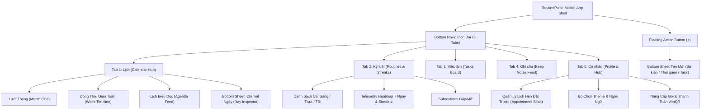
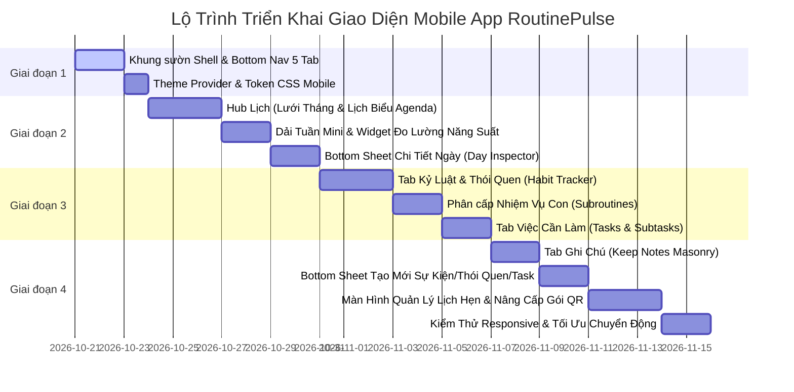

# Kế Hoạch Thiết Kế Giao Diện Mobile App RoutinePulse (Mobile UI Design Plan)

* **Phân hệ thực hiện:** Chuyển đổi toàn diện giao diện từ Web (`Frontend_Usersite_Web`) sang Mobile App
* **Tiêu chuẩn thiết kế:** Clean Anti-Slop System (Obsidian Swiss Precision + Google Material 3 Dark Architecture)
* **Công cụ thiết kế & Tạo mẫu:** Stitch MCP + MengTo Suite (`ui-new-designer`)
* **Stitch Project ID:** `7957729313718763106` (RoutinePulse Mobile App Suite)
* **File Showcase Trực Quan:** [mobile_suite_showcase.html](file:///e:/SideProject/Frontend_Usersite_Web/docs/ui-designs/previews/mobile_suite_showcase.html)
* **Hồ Sơ Đặc Tả Kỹ Thuật:** [ui_design_mobile_app_suite.md](file:///e:/SideProject/Frontend_Usersite_Web/docs/ui-designs/ui_design_mobile_app_suite.md)
* **Trạng thái:** Hoàn tất lập kế hoạch & sẵn sàng chuyển giao lập trình (Chờ lệnh người dùng kích hoạt `ui-clean-coder`)

---

## 1. Tổng Quan & Bối Cảnh Chuyển Đổi (Context & Objectives)

### 1.1. Hiện trạng bản Web (`Frontend_Usersite_Web`)
Bản web hiện tại được xây dựng bằng React + TypeScript + Tailwind CSS, tổ chức không gian làm việc theo dạng **3 cột (Liquid 3-Column Workspace)**:
- **Cột trái (Left Sidebar - 256px):** Nút tạo mới, lịch mini điều hướng tháng, danh mục lọc sự kiện (Routine, Event, Task, Màu sắc tùy biến), phím tắt mở Lịch hẹn đặt trước.
- **Cột giữa (Main Canvas):** Không gian hiển thị lịch trình đa năng (3 chế độ: `Lưới tháng - MonthGridView`, `Dòng thời gian tuần - WeekTimelineView`, `Lịch biểu - AgendaListView`) cùng thanh đo lường hiệu suất `ProductivityKPI`.
- **Cột phải (Right Companion Sidebar - 360px):** 3 tab công việc chính gồm Tasks (`TaskItem`, `SubtaskList`), Kỷ luật & Ghi chú (`NotesRoutineSidebarPanel`), và Danh bạ (`ContactsCompanionPanel`).
- **Hệ thống Popups & Modals:** `CreateEventModal`, `EventDetailModal`, `RecurringActionModal`, `AppointmentScheduleModal`, `SettingsModal`, `CheckoutModal`, `LimitModal`, `DayInspectorDrawer`.

### 1.2. Thách thức trên môi trường Di Động (Mobile Constraints)
Màn hình di động (chiều rộng 390px - 412px, chiều cao 844px - 915px) có diện tích hiển thị giới hạn. Nếu giữ nguyên layout cột sẽ gây ra:
1. **Xung đột điều hướng:** Không thể cùng lúc hiển thị cả 3 cột mà không làm người dùng hoa mắt.
2. **Kẹt ngón tay cái (Ergonomic Bottleneck):** Các nút bấm nhỏ trên thanh công cụ web rất khó bấm chính xác bằng một tay trên điện thoại.
3. **Card lồng Card (Container Fatigue):** Việc bọc modal trong modal hoặc chia nhỏ nhiều khung con sẽ làm giảm diện tích nội dung xuống dưới 40%.

### 1.3. Mục tiêu giải pháp thiết kế Mobile App
- **Đạt 100% tính năng của bản Web:** Không cắt xén bất kỳ nghiệp vụ nào (từ lặp lại sự kiện, hội nghị Meet, đo streak lửa, subroutines, keep notes, cài đặt lịch rảnh, đến thanh toán nâng cấp gói).
- **Tối ưu hóa thao tác 1 tay (One-handed Ergonomics):** Áp dụng thanh điều hướng đáy **5 Tab Navigation**, Floating Action Button (FAB) tạo nhanh, và các **Bottom Sheets kéo trượt tự nhiên**.
- **Chuẩn hóa thị giác Obsidian Swiss Precision:** Nền tối sâu `#121314`, phân tách khối bằng độ sáng tonal `#1F2021` và viền mảnh 1px `#2A2B2D`, loại bỏ hoàn toàn các hiệu ứng AI Design Slop.

---

## 2. Bảng Đối Chiếu Tính Năng Toàn Diện (Web vs. Mobile Parity Matrix)

Bảng dưới đây chứng minh phương án Mobile App đảm bảo **đầy đủ 100% tính năng** so với phiên bản Web:

| STT | Phân Hệ / Tính Năng Trên Web | Thành Phần Web Hiện Tại | Giải Pháp Thiết Kế Tương Ứng Trên Mobile App | Trải Nghiệm Tối Ưu Trên Di Động |
|:---:|---|---|---|---|
| **1** | **Điều hướng Lịch đa chế độ** | `TopHeader.tsx` + `MonthGridView.tsx` + `WeekTimelineView.tsx` + `AgendaListView.tsx` | **Tab 1: Lịch (Calendar Hub)**<br>Header sticky với Segmented Pill `[Tháng \| Tuần \| Biểu]`. Dải tuần mini 7 ngày Sticky Week Strip cuộn ngang mượt mà. | Lướt ngày nhanh bằng ngón cái; chuyển đổi 3 chế độ xem chỉ với 1 chạm. |
| **2** | **Đo lường Năng suất & Streak** | `ProductivityKPI.tsx` | **Habit Telemetry Strip**<br>Thanh widget tinh gọn nằm ngay trên dòng sự kiện hiển thị tỷ lệ hoàn thành (85%), chuỗi streak 🔥 và thanh tiến độ gradient 4px. | Nhận biết phong độ kỷ luật hàng ngày ngay khi vừa mở app mà không chiếm không gian lịch. |
| **3** | **Chi tiết ngày (Day Inspector)** | `DayInspectorDrawer.tsx` (Trượt từ cạnh phải) | **Bottom Sheet: Chi tiết ngày (Day Sheet)**<br>Chạm đúp vào bất kỳ ngày nào trên lịch sẽ trượt Bottom Sheet từ dưới lên hiển thị toàn bộ lịch trình, thói quen và ngày lễ của ngày đó. | Trượt lên xem nhanh, vuốt xuống đóng lại tiện lợi bằng cử chỉ tự nhiên của ngón tay. |
| **4** | **Kỷ luật & Thói quen hàng ngày** | `NotesRoutineSidebarPanel.tsx` (Mục Routines) | **Tab 2: Kỷ luật & Thói quen (Dedicated Habit Hub)**<br>Bộ lọc ca `[Tất cả \| Sáng \| Chiều \| Tối]`, heatmap mini 7 ngày, checkbox 1-chạm điểm danh, huy hiệu ngọn lửa Streak 🔥. | Check thói quen trong tích tắc khi thức dậy hoặc trước khi ngủ. |
| **5** | **Nhiệm vụ con của Thói quen (Subroutines)** | `CreateRoutineInput.subroutines` | **Thẻ thói quen phân cấp gập/mở (Expandable Subroutine Hierarchy)**<br>Các bước nhỏ (*10 trang kỹ thuật*, *10 trang tư duy*) nằm gọn gàng bên dưới thẻ thói quen cha kèm tỷ lệ hoàn thành (10/10). | Quản lý kỷ luật chi tiết mà không gây rác mắt màn hình. |
| **6** | **Quản lý Việc cần làm (Tasks)** | `TaskItem.tsx` + `SubtaskList.tsx` | **Tab 3: Việc làm (Task Management Screen)**<br>Danh sách công việc chia nhóm theo hạn chót (Hôm nay, Sắp tới), mức độ ưu tiên (High/Med/Low), thanh tiến độ Subtasks. | Chạm để tích hoàn thành, vuốt sang phải để sửa/lên lịch lại. |
| **7** | **Ghi chú cá nhân (Keep Notes)** | `NotesRoutineSidebarPanel.tsx` (Mục Keep Notes) | **Tab 4: Ghi chú (Notes & Ideas Feed)**<br>Lưới masonry card tối ưu di động, thẻ ghim ưu tiên, phân loại theo màu sắc (Amber, Blue, Green, Purple), checklist động và hashtag. | Ghi lại ý tưởng hoặc biên bản cuộc họp tức thì không độ trễ. |
| **8** | **Tạo mới Sự kiện / Thói quen / Task** | `CreateEventModal.tsx` | **Swipeable Bottom Sheet: Tạo mới (92% Viewport)**<br>Chuyển đổi 3 phân loại `[Sự kiện \| Thói quen \| Việc làm]`, nhập tiêu đề không viền, chọn giờ, bật Google Meet, thêm địa điểm & thời gian di chuyển, nhãn màu và ưu tiên. | Giữ nguyên ngữ cảnh lịch biểu mờ phía sau, lưu hoặc hủy dễ dàng. |
| **9** | **Thao tác Sự kiện Lặp lại** | `RecurringActionModal.tsx` | **Action Sheet Xử Lý Chuỗi Lặp**<br>Tùy chọn: *"Chỉ sửa/xóa sự kiện này"* hoặc *"Áp dụng cho tất cả sự kiện trong chuỗi lặp"*. | Tránh thao tác nhầm trên màn hình cảm ứng nhỏ. |
| **10** | **Cài đặt Lịch hẹn đặt trước (Booking)** | `AppointmentScheduleModal.tsx` | **Màn hình/Sheet: Quản lý Lịch hẹn (Booking Manager)**<br>Bật/tắt các thứ trong tuần (T2 - CN), thêm các khoảng giờ rảnh (TimeRange), sao chép link đặt lịch cá nhân, cấu hình thời gian đệm. | Tự tin chia sẻ link lịch hẹn cho đối tác ngay từ điện thoại. |
| **11** | **Hồ sơ, Giao diện & Chủ đề (Themes)** | `SettingsModal.tsx` | **Tab 5: Cá nhân & Cài đặt (Profile & Settings)**<br>Xem thông tin tài khoản, đổi ảnh đại diện/ngày sinh, chuyển đổi ngôn ngữ (Vi/En), đổi Theme thật (Dark, Mặc định, Tết, Sakura,...). | Quản lý toàn bộ cấu hình cá nhân tại một điểm tập trung. |
| **12** | **Nâng cấp gói & Thanh toán QR** | `CheckoutModal.tsx` + `LimitModal.tsx` | **Bottom Sheet: Gói dịch vụ & Quét mã VietQR**<br>So sánh gói Basic/Pro/VIP, tạo mã QR chuyển khoản tự động kèm nút sao chép thông tin thanh toán nhanh. | Thanh toán nâng cấp tài khoản mượt mà trên ứng dụng ngân hàng di động. |
| **13** | **Cổng Đăng nhập / Đăng ký** | `LoginPage.tsx` + `AuthForm.tsx` | **Mobile Auth Flow**<br>Màn hình đăng nhập/đăng ký gọn gàng, hỗ trợ đăng nhập Google Workspace 1-chạm và carousel giới thiệu tính năng tối giản. | Nhập liệu nhanh với bàn phím di động tự động tối ưu kiểu dữ liệu. |

---

## 3. Kiến Trúc Điều Hướng & Trải Nghiệm Người Dùng (Information Architecture)



### 3.1. Phân tích chi tiết 5 Tab chính
1. **Tab 1 - Lịch (`Calendar`):**
   - **Header:** Sticky với tên tháng/năm, công tắc chuyển `Tháng | Tuần | Biểu`, nút tìm kiếm và Avatar.
   - **Sticky Week Strip:** Dải 7 ngày của tuần hiện tại với số ngày và chấm sự kiện nhiều màu.
   - **Habit Telemetry Strip:** Thước đo hiệu suất ngày (VD: `85%`) và chuỗi streak lửa `🔥 14 ngày`.
   - **Nội dung chính:** Lịch biểu thời gian liên tục 06:00 – 23:00, thẻ sự kiện có nhãn rõ ràng (Meet, Địa điểm, Khách mời).
2. **Tab 2 - Kỷ luật (`Routines`):**
   - **Hero Card:** Tổng chuỗi kỷ luật, tỷ lệ hoàn thành hôm nay, biểu đồ heatmap 7 ngày từ T2 đến CN.
   - **Bộ lọc ca:** Chips bấm nhanh `Tất cả (4)`, `Buổi sáng (2)`, `Buổi chiều (1)`, `Buổi tối (1)`.
   - **Danh sách thói quen:** Thẻ bài phẳng, nút tick tròn công thái học 48px, nhãn thời gian và danh mục. Hỗ trợ hiển thị các việc con `Subroutines`.
3. **Tab 3 - Việc làm (`Tasks`):**
   - Phân loại theo độ ưu tiên `Cao (Coral)`, `Trung bình (Amber)`, `Thấp (Blue)`.
   - Danh sách công việc kèm hạn chót (Due date), thẻ nhãn danh mục và tiến độ việc nhỏ (VD: `3/4 việc nhỏ hoàn thành`).
4. **Tab 4 - Ghi chú (`Notes`):**
   - Bố cục dạng Masonry Feed linh hoạt theo độ dài ghi chú.
   - Hỗ trợ ghim ghi chú quan trọng lên đầu, tô màu thẻ (Amber, Blue, Green, Purple), danh sách việc cần làm (Checklist tương tác) và hashtag.
5. **Tab 5 - Cá nhân (`Profile`):**
   - Thông tin cá nhân, vai trò và hạn mức tài khoản (Free / Pro / VIP).
   - Module quản lý **Lịch hẹn đặt trước (Appointment Scheduling)**: cấu hình dải giờ rảnh các thứ trong tuần, link đặt chỗ cá nhân.
   - Module chọn **Chủ đề giao diện (Themes)** và **Ngôn ngữ (Tiếng Việt / English)**.
   - Module **Nâng cấp gói tài khoản (Subscription & VietQR Checkout)**.

---

## 4. Hệ Thống Design Tokens & Thẩm Mỹ Di Động (Obsidian Swiss Precision)

### 4.1. Bảng Màu Chuẩn (Material 3 Dark Workspace Palette)
```css
:root {
  /* Surfaces */
  --surface-base: #121314;           /* Canvas gốc, sâu thẳm, chống chói */
  --surface-container-low: #1b1c1d;  /* Khối nền con, thẻ lồng */
  --surface-container: #1f2021;      /* Khối thẻ sự kiện, bottom sheet */
  --surface-container-high: #28292a; /* Nút active, chip đã chọn, popover */
  --surface-container-highest: #343536;

  /* Hairline Borders */
  --border-subtle: #2a2b2d;          /* Đường kẻ 1px cấu trúc */
  --border-focus: #8ab4f8;           /* Viền xanh sáng khi chọn */

  /* Typography Colors */
  --text-primary: #e3e2e3;          /* Độ tương phản cao (> 12:1) */
  --text-secondary: #9aa0a6;        /* Nhãn mô tả, thông số phụ */
  --text-muted: #5f6368;            /* Placeholder, watermark */

  /* Functional Accents */
  --color-google-blue: #8ab4f8;     /* Sự kiện, Active tab, Nút chính */
  --color-habit-amber: #fdd663;     /* Thói quen kỷ luật, Streak lửa 🔥 */
  --color-task-green: #81c995;      /* Nhiệm vụ hoàn thành, Checkbox */
  --color-danger-coral: #f28b82;    /* Ưu tiên cao, Báo động, Hủy/Xóa */
  --color-note-purple: #c58af9;     /* Ghi chú cá nhân, Nhãn đặc biệt */
}
```

### 4.2. Quy Tắc Chống Rác Thiết Kế (Anti-Slop Strict Standards)
- **Không nhồi nhét bóng mờ (No decorative stacking):** Nghiêm cấm việc bọc nhiều tầng bóng đổ loang lổ. Chiều sâu được tạo dựng bằng các bước tăng độ sáng bề mặt tự nhiên (`#121314` -> `#1F2021` -> `#28292A`).
- **Không lạm dụng bo góc vô nghĩa:** Chỉ dùng bo góc có kỷ luật (`rounded-xl` 12px cho thẻ, `rounded-2xl` 16px cho bottom sheet, `rounded-full` cho các chip lọc và nút FAB).
- **Mật độ thông tin tương xứng (Density Matching):** Không kéo dãn khoảng cách như landing page tiếp thị; padding thẻ được cố định ở mức 12px – 14px để hiển thị được nhiều mục trên một màn hình.
- **Số liệu dạng Tabular Figures:** Mọi mốc thời gian, tỷ lệ phần trăm và chuỗi streak đều áp dụng `font-variant-numeric: tabular-nums` để số không bị nhảy vị trí khi cập nhật.

---

## 5. Kế Hoạch Lộ Trình Triển Khai (Implementation Roadmap)

Quá trình hiện thực hóa giao diện Mobile App sẽ được chia thành **4 giai đoạn chặt chẽ**:



### Chi tiết các giai đoạn:
* **Giai đoạn 1: Nền tảng Shell Di Động & Hệ Thống Điều Hướng Đáy (3 ngày):**
  - Xây dựng `MobileAppShell.tsx`, `MobileBottomNav.tsx` (5 tabs) và `MobileTopHeader.tsx`.
  - Tích hợp chuẩn nhận diện kích thước thiết bị di động (Responsive Breakpoint `< 768px`) hoặc chạy độc lập.
* **Giai đoạn 2: Trọng Tâm Lịch Trình & Chi Tiết Ngày (7 ngày):**
  - Chuyển hóa `MonthGridView` và `AgendaListView` sang cấu hình cảm ứng di động.
  - Tích hợp `StickyWeekStrip.tsx` và widget `ProductivityKPI` tinh gọn.
  - Xây dựng `DayInspectorSheet.tsx` thay thế drawer bên phải.
* **Giai đoạn 3: Phân Hệ Kỷ Luật Thói Quen & Việc Cần Làm (7 ngày):**
  - Xây dựng màn hình `MobileRoutineScreen.tsx` với bộ lọc ca, checkbox điểm danh 1 chạm và streak lửa.
  - Tích hợp cụm `Subroutines` gập mở mượt mà.
  - Xây dựng `MobileTasksScreen.tsx` phân loại công việc theo độ ưu tiên và hạn chót.
* **Giai đoạn 4: Ghi Chú, Quản Lý Lịch Hẹn, Modal Tạo Mới & Thanh Toán (9 ngày):**
  - Xây dựng `MobileKeepNotesScreen.tsx` dạng masonry thẻ màu.
  - Hoàn thiện `MobileCreateBottomSheet.tsx` với 3 phân loại (Sự kiện / Thói quen / Task) và kết nối Google Meet.
  - Hiện thực hóa màn hình `MobileAppointmentManager.tsx` và `MobileCheckoutSheet.tsx` (Quét mã VietQR).
  - Tinh chỉnh vi chuyển động (Micro-interactions) bằng CSS/GSAP và kiểm thử toàn diện trên các kích thước màn hình phổ biến.

---

## 6. Liên Kết Tài Nguyên & Mockup Demo

Toàn bộ các bản thiết kế giao diện trực quan đã được sinh từ **Stitch MCP** và lưu trữ đầy đủ trong thư mục `docs/ui-designs/`:
1. **Showcase Tương Tác 100% Tính Năng (Interactive Prototype Demo):**
   - [mobile_suite_showcase.html](file:///e:/SideProject/Frontend_Usersite_Web/docs/ui-designs/previews/mobile_suite_showcase.html): Cho phép chuyển tab, đổi view Lịch (Tháng / Tuần / Biểu), tick hoàn thành thói quen/task, mở Bottom Sheet tạo mới, cấu hình lịch hẹn, quét mã VietQR và đăng nhập/đăng xuất ngay trên trình duyệt.
2. **Bộ 8 Màn Hình Mockup Độc Lập:**
   - [mobile_calendar_hub_mockup.html](file:///e:/SideProject/Frontend_Usersite_Web/docs/ui-designs/previews/mobile_calendar_hub_mockup.html): Hub Lịch Tháng, Tuần, Lịch biểu & Sticky Week Strip.
   - [mobile_routine_tracker_mockup.html](file:///e:/SideProject/Frontend_Usersite_Web/docs/ui-designs/previews/mobile_routine_tracker_mockup.html): Kỷ luật thói quen theo ca, chuỗi streak lửa 🔥 & heatmap.
   - [mobile_create_sheet_mockup.html](file:///e:/SideProject/Frontend_Usersite_Web/docs/ui-designs/previews/mobile_create_sheet_mockup.html): Bottom Sheet tạo nhanh Sự kiện / Thói quen / Việc làm.
   - [mobile_tasks_mockup.html](file:///e:/SideProject/Frontend_Usersite_Web/docs/ui-designs/previews/mobile_tasks_mockup.html): Quản lý việc cần làm, ưu tiên & Subtasks.
   - [mobile_notes_mockup.html](file:///e:/SideProject/Frontend_Usersite_Web/docs/ui-designs/previews/mobile_notes_mockup.html): Ghi chú Keep Notes thẻ màu, ghim & checklist.
   - [mobile_appointment_mockup.html](file:///e:/SideProject/Frontend_Usersite_Web/docs/ui-designs/previews/mobile_appointment_mockup.html): Quản lý Lịch hẹn đặt trước (Appointment Hub) & link chia sẻ.
   - [mobile_profile_settings_mockup.html](file:///e:/SideProject/Frontend_Usersite_Web/docs/ui-designs/previews/mobile_profile_settings_mockup.html): Cá nhân, Cài đặt theme, Gói dịch vụ & VietQR Checkout.
   - [mobile_auth_mockup.html](file:///e:/SideProject/Frontend_Usersite_Web/docs/ui-designs/previews/mobile_auth_mockup.html): Cổng Đăng nhập / Đăng ký di động.
3. **Hồ Sơ Đặc Tả Kỹ Thuật UI Chuẩn Stitch MCP:**
   - [ui_design_mobile_app_suite.md](file:///e:/SideProject/Frontend_Usersite_Web/docs/ui-designs/ui_design_mobile_app_suite.md)

---

## 7. Trạng Thái Chuyển Giao (Handoff & Next Steps)

> [!IMPORTANT]
> **Tuân thủ nghiêm ngặt nguyên tắc cốt lõi:**
> *"Coding: Không bao giờ được sửa code cho đến khi người dùng thực sự bảo sửa".*
>
> Toàn bộ kế hoạch và hồ sơ thiết kế đã được lập xong và lưu vào thư mục `docs/`. Hệ thống đang dừng lại để xin ý kiến đánh giá từ bạn.
> Khi bạn đồng ý với kế hoạch và bản thiết kế này, hãy ra lệnh để kích hoạt Skill `ui-clean-coder` bắt đầu tiến hành viết mã nguồn vào dự án!
